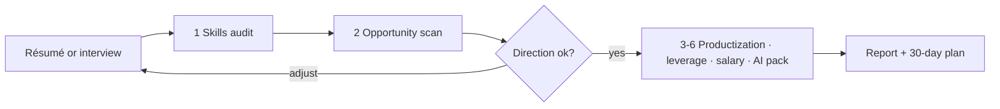

<a id="top"></a>

<div align="center">

# 💰 monetize

**Turn your career history into an honest, actionable side-income plan — inside your AI agent.**

把你的职业经历，变成一份诚实、可执行的变现方案

[](LICENSE)
[](https://agentskills.io)
[](https://github.com/zhengqiuyang/monetize-skill/stargazers)
[](https://github.com/zhengqiuyang/monetize-skill/commits/main)

```bash
npx skills add zhengqiuyang/monetize-skill
```

[What it is](#what) · [Why](#why) · [How it works](#how) · [Install](#install) · [Usage](#usage) · [Sample](#sample) · [Principles](#principles) · [Markets](#markets)

Works with **Claude Code · Codex · Cursor · Gemini CLI** and any [Agent Skills](https://agentskills.io)-compatible agent.

</div>

---

<a id="what"></a>

## What it is / 这是什么

A six-module skill that turns one person's real experience into an income plan they can start this week. It reads a résumé, or interviews in three short rounds, then produces a report with sourced numbers, one leverage action, and a 30-day checklist.

一个六模块技能：把一个人的真实经历变成"本周就能开始"的收入方案。读简历，或分三轮轻访谈（每轮 3–4 个问题），最后产出一份带来源的报告、一个杠杆动作和一份 30 天清单。

<a id="why"></a>

## Why / 为什么

Generic "how do I make money with AI" prompts are one-off: paste a prompt, get ten interchangeable ideas and invented salary figures, lose the thread. `monetize` is a workflow instead.

| One-off prompt | 💰 monetize |
|---|---|
| Paste a prompt, re-explain your background | Parses a résumé, or interviews in short rounds; the profile is saved and reused |
| Invents salary and market figures | Numbers are verified online with sources, or explicitly labeled "estimate" |
| Ten options, all equal weight | Forces convergence: **one action to start this week** + a 30-day checklist |
| Output dies in the chat | A structured report with a source appendix and an unverified-estimate appendix |
| Hype and promises | No income promises; competition, risks and failure modes stated; no gray-area methods |

<a id="how"></a>

## How it works / 工作流



Runs modules 1–2 first so you can confirm the direction, then 3–6 to assemble the report — a 5,000-word output never lands pointing the wrong way.

先跑模块 1–2 让你确认方向，再跑 3–6 合成报告——避免一次输出 5000 字后才发现方向跑偏。

<a id="install"></a>

## Install / 安装

```bash
# Recommended — installs into your agent's skill directory
npx skills add zhengqiuyang/monetize-skill
```

```bash
# Manual
git clone https://github.com/zhengqiuyang/monetize-skill.git ~/.agents/skills/monetize
```

> [!NOTE]
> New sessions pick it up automatically. Any agent that reads `SKILL.md` files can load it — the skill follows the open [Agent Skills](https://agentskills.io) standard.

<a id="usage"></a>

## Usage / 用法

Just ask in natural language — the skill triggers on career and income questions:

```text
# Résumé intake
分析我的变现潜力，目标每月多赚 5000
@resume.pdf

# Guided interview
我做了 5 年会计，想搞点副业

# Single module
我是做运营的，帮我看看薪资天花板
```

English works the same: *"what side hustle fits my background?"*, *"how much can I make consulting on the side?"*

> [!TIP]
> You can also name it explicitly: "use the monetize skill on @resume.pdf".

<a id="sample"></a>

## What you get / 你会得到

<details>
<summary><strong>Report structure（点击展开）</strong></summary>

```markdown
# 变现潜力分析报告
## 0. 核心资产画像            ← 一段话说清你最值钱的是什么
## 1. 隐藏技能审计            ← 10 项被低估技能 × 谁付费 × AI 如何放大
## 2. 收入机会扫描            ← 10 条路径 × 启动成本/时间/难度/收入区间（附来源）
## 3. 变现产品化建议          ← 服务 / 咨询 / 数字产品 / 自由职业 offer
## 4. 最大杠杆点              ← 只有一个"本周就开始"的动作
## 5. 薪资天花板对标          ← 更高薪岗位 × 资格差距 × 过渡路径
## 6. AI 副业启动包           ← 5 个每周 <5 小时的 AI 辅助服务
## 7. 30 天行动清单           ← 每项带验收标准
## 附录 A 数据来源 / 附录 B 未核实估算清单
```

</details>

> [!TIP]
> [assets/report-sample.md](assets/report-sample.md) is a complete run from a real session (fictional persona, live web verification, 2026-10-31). The verified data changed the plan: domestic listing copy turned out to be a ¥50–200 red ocean, while comparable diagnostic services price at $20–297 overseas — so the report recommends diagnosis plus follow-along instead of writing copy. That is what a prompt that makes up numbers cannot do.

<a id="principles"></a>

## Design principles / 设计原则

Four rules decide what the report may and may not say.

| 原则 | 落地方式 |
|---|---|
| **具体压倒通用** | 每个结论必须追溯到用户的具体经历；拒绝"你可以做咨询"式空话 |
| **数字要么核实、要么标注** | 联网核实并给出来源；核实不了的写进"未核实估算清单" |
| **诚实压过讨好** | 不承诺收入；明示前 3 个月收入通常远低于稳定期 |
| **反分析瘫痪** | 10 条机会不等于都做：只给 1 个杠杆点 + 2 个备选及放弃理由 |

<a id="markets"></a>

## Market adaptation / 市场适配

The skill switches market assumptions by the user's language, city and employer, and states the assumption at the top of the report.

| | 🇨🇳 中国大陆（默认） | 🇺🇸 北美 | 🇪🇺 欧洲 |
|---|---|---|---|
| 货币 | ¥ | $ | € |
| 平台 | 闲鱼、小红书、猪八戒、在行 | Upwork、Fiverr、Etsy、Gumroad | Malt、Fiverr、Etsy |
| 薪资来源 | 看准网、脉脉、BOSS 直聘 | levels.fyi、Glassdoor、BLS | Glassdoor、StepStone |

## Contributing / 贡献

Issues and PRs are welcome. Especially useful: anonymized real-run report samples for `assets/`, compatibility reports for other agents, and platform or salary data for markets outside mainland China.

欢迎 Issue 和 PR。特别欢迎：脱敏后的真实运行报告样本（放到 `assets/`）、其他智能体的兼容性反馈、非中国市场的平台与薪资数据源。

> [!WARNING]
> **Disclaimer / 免责声明**：本技能仅提供分析思路，不构成理财、法律或税务建议。开展任何收入活动前请自行核查劳动合同兼职条款、平台规则与当地法规。
> This skill provides educational analysis, not financial, legal, or tax advice.

## License / 许可

[MIT](LICENSE) © 2026 zhengqiuyang
