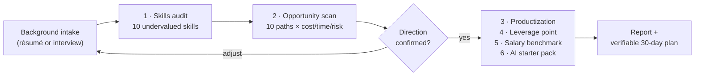

<a id="top"></a>

<div align="center">

# 💰 monetize

**Turn your career history into an honest, actionable side-income plan — inside your AI agent.**

把你的职业经历，变成一份诚实、可执行的变现方案

[](LICENSE)
[](https://agentskills.io)
[](SKILL.md)
[](https://github.com/zhengqiuyang/monetize-skill/stargazers)
[](https://github.com/zhengqiuyang/monetize-skill/commits/main)

```bash
npx skills add zhengqiuyang/monetize-skill
```

[Install](#install) · [Usage](#usage) · [Sample Report](#sample) · [Principles](#principles) · [Markets](#markets)

Works with **Claude Code · ZCode · Cursor · Codex** and any [Agent Skills](https://agentskills.io) compatible agent

</div>

---

## Why / 为什么做这个

"用 AI 分析我能怎么赚钱"的提示词到处都是。它们的问题不是没用，而是**一次性**：粘贴一段 prompt，得到一堆通用建议和编造的薪资数字，聊完就散。

`monetize` 把这件事做成了结构化工作流：

| 一次性提示词 | 💰 monetize |
|---|---|
| 手动粘贴 prompt + 手动补背景 | 简历直接解析，或分轮轻访谈（每轮 3-4 问），背景存档可复用 |
| AI 编造薪资和市场价 | 关键数字**联网核实给来源**，核实不了的明确标注"估算" |
| 10 条建议全部平等呈现 | 强制收敛：**只给 1 个"本周就开始"的动作** + 可验收的 30 天清单 |
| 输出停留在聊天记录 | 落成结构化报告文件，含数据来源附录和未核实估算清单 |
| 鸡血和承诺 | 诚实守则：不承诺收入、点出竞争与风险、拒绝灰色玩法 |

## How it works



先跑「技能审计 + 机会扫描」给你确认方向，再跑后四个模块合成完整报告——防止单次输出 5000 字后才发现跑偏。

<a id="install"></a>

## Install / 安装

```bash
# Recommended — installs into your agent's skill directory
npx skills add zhengqiuyang/monetize-skill
```

```bash
# Manual
git clone https://github.com/zhengqiuyang/monetize-skill.git ~/.agents/skills/monetize
```

> [!NOTE]
> 安装后在新会话中生效。Any agent that reads `SKILL.md` files can load it — the skill follows the open [Agent Skills](https://agentskills.io) standard.

<a id="usage"></a>

## Usage / 用法

```text
# Full run — guided interview intake
/monetize 我做了5年会计，想搞点副业

# Full run — résumé intake
/monetize @resume.pdf 分析我的变现潜力，目标每月多赚 5000

# Single module
/monetize 我是做运营的，帮我分析薪资天花板
```

自然语言同样触发："帮我看看能做什么副业"、"我的技能怎么变现" / "what side hustle fits my background?"。

<a id="sample"></a>

## What you get / 你会得到

<details>
<summary><strong>报告结构（点击展开）</strong></summary>

```markdown
# 变现潜力分析报告
## 0. 核心资产画像            ← 一段话说清你最值钱的是什么
## 1. 隐藏技能审计            ← 10 项被低估技能 × 谁付费 × AI 如何放大
## 2. 收入机会扫描            ← 10 条路径 × 启动成本/时间/难度/收入区间（附来源）
## 3. 变现产品化建议          ← 服务 / 咨询 / 数字产品 / 自由职业 offer
## 4. 最大杠杆点              ← 只有一个"本周就开始"的动作
## 5. 薪资天花板对标          ← 更高薪岗位 × 资格差距 × 过渡路径
## 6. AI 副业启动包           ← 5 个每周 <5 小时的 AI 辅助服务
## 7. 30 天行动清单           ← 每项带验收标准
## 附录 A 数据来源 / 附录 B 未核实估算清单
```

</details>

> [!TIP]
> [assets/report-sample.md](assets/report-sample.md) 是一次**真实运行**的完整产出（虚构人设 + 实时联网核实，2026-10-31）。真实数据直接改写了策略方向：国内 listing 文案已是 ¥50-200/条的红海，而同类"诊断"服务海外报价 $20-297——报告因此推荐"诊断+陪跑"而非接单写文案。这是编造数字的 prompt 做不到的。

<a id="principles"></a>

## Design principles / 设计原则

| 原则 | 落地方式 |
|---|---|
| **具体压倒通用** | 每个结论必须追溯到用户的具体经历；拒绝"你可以做咨询"式空话 |
| **数字要么核实、要么标注** | WebSearch 核实给来源；否则写入"未核实估算清单"——宁可少给数字 |
| **诚实压过讨好** | 不承诺收入；明示前 3 个月收入通常远低于稳定期；主动提示劳动合同、平台规则、税务、资质风险 |
| **反分析瘫痪** | 10 条机会不等于都做；收敛到 1 个杠杆点 + 2 个备选及放弃理由 |

<a id="markets"></a>

## Market adaptation / 市场适配

技能按用户语境（语言、城市、雇主所在地）自动切换市场假设，报告开头注明：

| | 🇨🇳 中国大陆（默认） | 🇺🇸 北美 | 🇪🇺 欧洲 |
|---|---|---|---|
| 货币 | ¥ | $ | € |
| 平台 | 闲鱼、小红书、猪八戒、在行 | Upwork、Fiverr、Etsy、Gumroad | Malt、Fiverr、Etsy |
| 薪资源 | 看准网、脉脉、BOSS 直聘 | levels.fyi、Glassdoor、BLS | Glassdoor、StepStone |

## Contributing / 贡献

欢迎 Issue 和 PR。**特别欢迎**：用真实背景跑出的报告样本（脱敏后提交到 `assets/`）、各智能体的兼容性反馈、非中国市场的平台与薪资数据源补充。

> [!WARNING]
> ## Disclaimer / 免责声明
> 本技能仅提供分析思路，不构成理财、法律或税务建议。开展任何收入活动前请自行核查劳动合同兼职条款、平台规则与当地法规。
> This skill provides educational analysis, not financial, legal, or tax advice.

## License / 许可

[MIT](LICENSE) © 2026 zhengqiuyang
